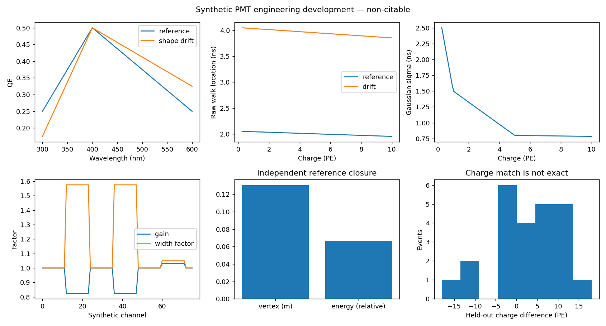

# PMT issue 5 engineering closeout

> Historical WP0–WP5 CPU closeout. The subsequent user-authorized real LUCiD integration, prompt Cherenkov validation and three-seed GPU pilot are complete within their bounded engineering scope: [follow-up report](PMT_LUCID_INTEGRATION_REPORT_2026-10-16.md). The old no-training/exporter deferrals below describe the earlier pass.

16 October 2026. **The scientific issue is partially complete.** This pass delivers reversible WP0–WP5 engineering mechanisms, synthetic acceptance tests, WP6/WP8 drafts and WP9 engineering evidence. It does not establish target-detector calibration, scientific superiority, physics review, issue closure or release.

## ✅ Requirement evidence

Paths below refer to `src/noise_module_lucid/` for code and `tests/test_pmt_contract.py` for named tests, unless fully qualified. Evidence root is `results/pmt_dev_2026-10-16_wp0_wp5/`; final fixture is `prompt_run_05/`.

| Requirement | Source | Code/document | Test/result evidence | Result | Remaining boundary |
|---|---|---|---|---|---|
| J1 | Issue #4; runbook §2 | configs/lucid_pmt/cell_contract.json excludes electronics and M | Registry regression and manifest inspection | Complete exclusion | No new electronics claims |
| J2 | Issue #5 comment 6134579713 QE bullets; thesis §§3.3.2,4.2 | quantum_efficiency.py; photon_contract.py; readout.py | test_qe_domain_interpolation_and_drift; test_analytic_rate; test_exact_degeneracy_and_persistent_pairing; controls.json | Synthetic mechanism passes | Target QE/CE and upstream photon exporter pending; no causal identifiability claim |
| J3 | Same comment fixed-threshold/polynomial requests; thesis §5.3, §6.2 | timing_response.py; readout.py; per-channel frozen curves | test_timing_sign_identity_width_and_membership; test_charge_conditioned_gaussian_widths; test_per_channel_walk_and_frozen_reference; test_polynomial_discriminator_uses_declared_pe_peak | Synthetic mechanism passes | Gaussian digit approximation; no measured target curve or asymmetric thesis reproduction |
| J4 | Same comment baseline B-field amplitude/width | group_response.py; ResponseCellSpec explicit causal_control/changed_fields | test_group_coupling_controls_and_one_field_rule; matrix group controls | Synthetic mechanism passes | Physical crate map and field calibration missing; proxy only |
| J5 | Same comment baseline-only training acceptance | pmt_development.fixture includes group response and T-Q before any training | Prompt reference closure; no model checkpoints | Baseline fixture passes | WP7 >=3/target5 seed training not run |
| J6 | Same comment prompt/uniform AA/no concentrator | toy.prompt_source_event; photon_contract.py; lucid_adapter.py | test_adapter_requires_actual_fields; test_double_qe_tts_and_observation_firewall | Synthetic fixture passes | Actual prompt Cherenkov sample unavailable |
| J7 | Same comment harm/cone suggestion; thesis §3.2 | calibration.py; consequence.py; dataset.run_response_matrix | test_calibration_disjoint_hash_binding_and_endpoint_failure; test_point_source_exact_tof_closure; closure/summary.json | Point-source engineering passes | Track/cone validation and D-K primary policy pending |
| J8 | Issue #5 comment 6133100584 | PMT_SOURCE_AND_STAGE_CONTRACT.md; active PMT documentation notices | Live source reconciliation and pinned upstream root | Research-use record updated | Licence file absent at retrieval; redistribution/release unapproved |
| J9 | Issue #4; issue #5 final exchange | PMT_EXPERIMENT_CONTRACT.md WP8 table | Documentation only; TIDMAD injection regression | Decision preparation complete | D-S/D-T and real-data transfer execution deferred |
| J10 | Issue #4 two-claim focus; PREREGISTRATION §§1–8 | PMT_EXPERIMENT_CONTRACT.md; split/cell manifests | No claim comparison, training or power study | Draft only | Physics validation, precision design, models and held-out comparison remain |
| J11 | Runbook WP0/WP5/WP9 | Status, source contract, final report; independent evidence flags | test_lucid_name_does_not_make_development_citable; 72 legacy exact comparisons | Engineering docs/tests complete | Scientific issue remains partially complete |

Source URLs: [current corrections](https://github.com/seanxia8/VERITAS/issues/5#issuecomment-6134579713), [research use](https://github.com/seanxia8/VERITAS/issues/5#issuecomment-6133100584), [parent steering](https://github.com/seanxia8/VERITAS/issues/4). Thesis and upstream line locators are in [source contract](PMT_SOURCE_AND_STAGE_CONTRACT.md).

## 🧪 Validation results

| Check | Actual result | Evidence |
|---|---|---|
| Original PMT baseline | 68 passed in 4.51 s | commands.md; starting HEAD |
| Final PMT suite | 93 passed in 5.10 s | pmt_tests_final.log |
| Shared noise regression, unchanged temporary package copy | 145 passed, 7 warnings in 4.35 s | noise_tests.log |
| Latent-monitor and TIDMAD injection regression | 104 passed, 2 skipped in 10.83 s | latent_tidmad_tests.log |
| Legacy digits | All 72 comparisons exactly equal (12 events ×6 settings) | compare_legacy.py; legacy_comparison.json |
| Prompt reference closure | 16 disjoint events: zero failed fits, mean vertex error 0.130533 m, mean relative energy error 0.066817 | prompt_run_05/closure/summary.json |
| Exact degeneracy | QE doubled, CE halved: sensor/charge/time arrays identical on all 24 evaluation events | prompt_run_05/controls.json |
| QE spectrum integral | Synthetic uniform spectrum: detection probability .300 reference, .310 shape drift | prompt_run_05/controls.json |
| Hash binding | All recorded code/config SHA-256 match final files | prompt_run_05/validation.json |

Python is `/Users/wongdowling/Documents/VERITAS/.venv/bin/python` (3.12.7); NumPy 2.5.3, SciPy 1.18.1, pytest 9.1.1. No sync, GPU, training or remote job. Torch and h5py tests were skipped because those dependencies are absent. JAX/LUCiD are absent; no real-simulator validation is claimed. Noise warnings are existing marker-registration/deprecation warnings under the temporary test root.

The first new unit run failed noiseless vertex closure (5.684 cm error). A detector-scale initial simplex repaired optimizer initialization; the 2 mm tolerance was unchanged. Two prompt attempts stopped on declared charge-domain boundaries: 4000-photon occupancy exceeded 100 PE, then the reduced 1000-photon fixture exposed the inherited sampled-template peak convention below .25 PE. New polynomial mode now uses continuous PE peak units with an explicit boundary test. Legacy threshold-walk is unchanged. All failures and prior attempts are retained in `validation_history.md`, `prompt_run_01/STOP.md` and `prompt_run_02/STOP.md`.

The first regression invocation was blocked because its existing setup writes regenerable .dat files inside the shared noise package. A temporary copy avoided modifying that package. One copy attempt still used the original cwd for data paths (5 failures); another lacked the qp_simulator import path (collection error). Correcting only execution cwd/import paths produced the reported 145 passing tests; preserved logs identify both failures. No test tolerance was relaxed.

## 📊 Synthetic endpoint observations

All cells use the same 24 physical event IDs and frozen calibration from 32 separate events; 16 additional events provide held-out closure. Calibration SHA-256: `7b75d7f3f99a72001e9c65f52061b67bfa3a5b1776eaeb2c3aa829202a977874`.

| Cell | Draft max endpoint K | Fit failures |
|---|---:|---:|
| Reference / identity | 1 / 1 | 0 / 0 |
| QE shape | 1.0721 | 0 |
| Fixed T-Q | 1.7330 | 0 |
| Timing width | 1.7288 | 0 |
| Coupled group | 1.5464 | 0 |
| Group gain only | 1.5464 | 0 |
| Group width only | 1.2935 | 0 |

Coupled and gain-only max K are equal in this fixture because the energy endpoint dominates. QE shape stays below provisional 1.10; this is retained, not used to enlarge its severity. These are development diagnostics, not a comparison of learned representations. The charge-matched comparison retains count, charge-shape, spatial and timing residuals and is explicitly not exact degeneracy. No claim-comparison plot is fabricated: no models were trained.

## 🔧 Compatibility and ownership

Existing public imports and positional readout calls remain. `run_response_matrix` now requires an explicit frozen calibration argument; omitting it raises an actionable error instead of silently fitting evaluation events. `toy_response_run` supplies independent reference-fit events automatically. Historical stored toy evidence is untouched; regenerated consequence results intentionally differ because calibration isolation and optimizer initialization were repaired. New modules do not alter shared scientific packages.

Reference walk, reference offsets and discriminator calibration cannot be changed by a response cell. Pure fixed-T-Q cells can only change the walk curve. The multi-field group family explicitly declares its causal control and gain/width fields. The exact product diagnostic is separate from origin classes. Operational projections exclude truth, clean twins, wavelengths and intervention labels; full trained-monitor plumbing remains WP6–WP7 work.

## 🚧 Remaining scientific work

| Package | Delivered now | Still outstanding |
|---|---|---|
| WP0 | Source reconciliation, baseline and status | None within local engineering scope |
| WP1 | Versioned units/ownership/observable and synthetic calibration manifest | Target hardware PMT identification and measured calibration |
| WP2 | Bounded wavelength QE, CE convention, pairing, exact/weak controls | Target wavelength-response validation and operational identifiability study |
| WP3 | Per-channel bounded polynomial, separate Gaussian width, frozen calibration | Target curves/width conventions and physics review |
| WP4 | Coupled proxy plus isolated controls, explicit field validation | Actual physical crate map and field-response calibration |
| WP5 | Strict interception-record adapter, prompt fixture, isolated calibration, endpoint/failure/evidence repairs | Actual upstream exporter, prompt Cherenkov run, track target and cone inputs |
| WP6 | Draft model/data/split/cell/comparison contract | S support, precision counts, held-out grid, D-K and compute decisions |
| WP7 | Not run | Baseline model training and both claim comparisons |
| WP8 | Concise decision list | D-T/D-L/D-M/D-S author decisions; no new arm launched |
| WP9 | Engineering tests, plots, source-bound report and proposed reply | Physics review and scientific closeout |

## 💬 Proposed issue reply (not posted)

> I implemented the first PMT correction pass on an isolated branch. It adds bounded wavelength-dependent QE/CE, persistent photon pairing and an exact observable-degeneracy control; fixed-threshold per-channel polynomial T-Q with separate charge-dependent timing width; and coupled group gain/width response with isolated controls. Reference physical timing noise remains present. The old threshold-shift family keeps its historical meaning.
>
> Energy and dead-map calibration now use a separate hashed reference-fit artifact. Missing endpoints or failed fits make the cell unevaluable, with failure rates and complete-case diagnostics reported separately. All outputs remain development/non-citable, including any LUCiD-sourced output. Your research-use clarification is recorded separately from licence-file and release status.
>
> CPU checks passed: 93 PMT tests, 145 shared-noise tests and 104 latent-monitor/TIDMAD checks, with two optional-dependency skips. Prompt-only synthetic closure and the exact-degeneracy control pass; legacy readout replay is unchanged in 72 comparisons. These are engineering results only. The target PMT curves, physical crate map, pre-response LUCiD exporter/real Cherenkov validation, track/cone definition and D-K decisions remain open. I prepared the experiment/split contract and parent-issue decision list, but have not trained models, launched transfer work, or evaluated the two claims. The issue remains partially complete.

Changed source/config/documentation inventory: [changed_files.md](../results/pmt_dev_2026-10-16_wp0_wp5/changed_files.md). Local commit ID is available from the containing branch commit; no push or merge was performed.
