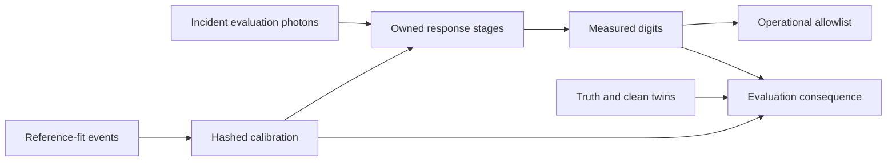

# PMT source and stage contract

16 October 2026. Version `pmt-response-v1`; development only.

## 📚 Source reconciliation

Issue #5 was re-read live, including all four comments: 6132747205 (historical implementation), 6133100584 (research use), 6134579713 (current corrections), 6134794683 (thesis). The runbook specification is unchanged. Issue #4 and its single acknowledgement 6083553525 were also read.[^issue5][^issue4]

Junjie wrote “We can just import and use LUCiD.” This supersedes the unanswered research-use request. Both pinned `eaf2e89f579d6679e90020c732ac2c846895d691` and the live main root lack a licence file on this retrieval. No release or redistribution approval is asserted. The old A0 email is obsolete and must not be sent.[^use][^root]

The local thesis SHA-256 is `f3bfaf51e9cedf9d0219a36de888b1e5b5e21168664ad0c52af2210f8caee7df`. Printed pages = PDF pages minus 3. Relevant text was inspected using local `pdftotext -layout` (LiteParse unavailable), including §§3.2–3.3.2, 4.2–4.4, 5.1, 5.2, 5.3, 6.1–6.2. Eq.5.13 is a piecewise polynomial in instrument Q-bin units. Eq.6.2 has exponent `-delta_t²/sigma²`; the Gaussian-core standard deviation is sigma/sqrt(2). Eq.6.3 has `-delta_t²/(2 sigma²)` and is an asymmetric normalized kernel; its mode and mean differ. This implementation uses a symmetric Gaussian at digit level, not either equation's calibrated asymmetric response. It does not copy SK coefficients, reverse time signs, or claim the local 2 PE width structure.[^thesis]

## 🔎 Pinned upstream audit

Source URLs and content SHA-256 are in `results/pmt_dev_2026-10-16_wp0_wp5/upstream_sources.json`.

| Location at eaf2e89 | Observed interface | Consequence |
|---|---|---|
| `simulation/simulator.py:119–137, 300–312` | `per_photon` returns QE-weighted likelihood arrays; wavelength sampling may itself be QE-weighted | This is not an unthinned photon list; wavelength_mode alone is insufficient |
| `simulation/sensor_response.py:199–250` | Bernoulli QE then per-photon TTS before first arrival | Reject a second full QE or full width application |
| `simulation/sensor_response.py:254–302` | Per-photon output includes already detected weights and true/smeared times | Lost photons and latent wavelengths are not restored by an adapter |
| `simulation/simulator.py:444–477` | QE convention is tied to reference wavelength and sensor reflectance | Interception must occur before QE; first trial disables reflection and QE-biased wavelength sampling |
| `simulation/digitizer.py:388–410, 490–550` | Charge/timing response, dark counts and digitization may be applied downstream | Bypass these when our chain owns these effects |
| `config/WCTE_geom_config.json` | Water cylinder reads `wcte_geometry.npz` | Candidate geometry is WCTE, not copied SK geometry |
| `config/WCTE_physics_config.json` | Scalar QE .2, 50 m scattering/absorption and nonzero reflection; no PMT type or crate map | Defaults do not satisfy prompt-only trial; target hardware, measured QE/width curves and mapping remain pending |

The original CPU-only pass had no LUCiD checkout, JAX or data bundle. In that pass, the strict `lucid_adapter.incident_record` validates an explicit pre-response interception record, but the upstream exporter and real Cherenkov integration were **not validated**. Its acceptance test is a synthetic record. A weighted likelihood ray is not an independent photon; do not cast weighted output into unit photons. Obtain hard direct sensor encounters with original photon IDs, wavelength and verified time units, with QE/TTS disabled, before passing the record.

## 🔧 Ownership and observation

| Effect | Prompt fixture owner | Constraint |
|---|---|---|
| Geometric interception | source | projected solid angle retained |
| Wavelength | source | uniform 300–600 nm, latent/evaluation only |
| QE and CE | readout | product probabilities, validated [0,1], applied once |
| SPE charge and gain | readout | PE before dimensionless gain |
| Fixed discriminator | readout | .25 PE continuous peak in polynomial mode; historical sampled-template convention retained in legacy mode |
| T-Q systematic location | readout | per-channel polynomial, degree ≤3, normalized bounded PE coordinate |
| Physical timing scatter | readout | one charge-dependent Gaussian digit kernel, no upstream TTS |
| Offsets/reference correction | readout | subtract frozen reference offset/walk only |
| Dead map | readout | independent calibration share for optional correction |
| Scattering/reflection/concentrator/dark/pre/after pulses | disabled | prompt first pass |
| Absorption/dispersion | disabled | fixed group velocity; declared synthetic approximation |

For gain changes, raw walk and width are recomputed at the changed measured charge. An unchanged reference walk calibration cancels the systematic walk at that charge, but threshold occupancy and physical width can still change. Pure T-Q preserves charge and pre-window membership. This driver applies no time window; `lost_time_window=0` is explicit.

Only sensor ID/position, measured charge/time, and known grouping cross `operational_digits`. Truth counts, wavelength, true vertex/energy, cell labels and clean twins stay outside. The helper monitor is an engineering projection test, not a replacement for `GENERIC_COMMITTED` or completed model-monitor integration.

## 🚧 Endpoint and identifiability boundaries

The exact control scales QE by two and CE by one half, preserving detection probability at every wavelength. Shared draws give identical measured digits; it introduces no origin class. The weaker control fits a gain to match mean charge on reference-fit events only and reports held-out occupancy, charge spread, spatial and timing residuals. Matching charge is not observable equality. Distinct hidden wavelength curves with equal marginal observations cannot be resolved from representations.

Point-source tests concern isotropic flashers and their defined emission point. Tracks are explicitly rejected by the response matrix. A cone diagnostic is deferred because the fixture has no track axis, particle mass/speed, phase refractive index, emission segments or Cherenkov cone. A real track endpoint requires an agreed truth target, frozen track reconstruction and independent closure. Group index governs ToF; phase index governs cone angle. Neither vertex nor cone angle alone establishes energy-loss history.[^thesis]

[^issue5]: https://github.com/seanxia8/VERITAS/issues/5#issuecomment-6134579713
[^issue4]: https://github.com/seanxia8/VERITAS/issues/4
[^use]: https://github.com/seanxia8/VERITAS/issues/5#issuecomment-6133100584
[^root]: https://github.com/CIDeR-ML/LUCiD/tree/eaf2e89f579d6679e90020c732ac2c846895d691
[^thesis]: Junjie Xia, July 2019, *Upgrade and Calibration of Super-Kamiokande's Inner Photodetectors*. https://www-sk.icrr.u-tokyo.ac.jp/sk/_pdf/articles/MasterThesis-XIA_JUNJIE-35176375.pdf

## Follow-up: actual prompt transport

The later user-authorized Deepthought pass implements `lucid_transport.PromptTransport` against a hash-verified pinned source and actual WCTE geometry. The 24-event PhotonSim Cherenkov source, mm-to-m conversion, pre-response interception, independent transport checks, local cone validation and three-seed direction pilot are documented in [the integration report](PMT_LUCID_INTEGRATION_REPORT_2026-10-16.md). This supersedes the original environment/exporter deferral above. PMT calibration, dispersive transport, track/energy endpoints and scientific claim evaluation remain unresolved.

## Follow-up: multi-energy track development

The [multi-energy report](PMT_MULTIENERGY_TRACK_REPORT_2026-10-16.md) records primary-start/direction/initial-energy development targets, physical-event-disjoint reconstruction splits, an independent response-fit split, actual upstream mPMT membership, the retained source-cap STOP and a pre-training balanced-cohort amendment. Photon emission cropping and upstream cylinder snapping are declared approximations, not geometry-matched Geant4 validation. The earlier point-source fixture remains point-source-only. The [decision register](PMT_CALIBRATION_AND_PROTOCOL_DECISIONS_2026-10-16.md) identifies the calibration and author choices needed before primary claim evaluation.
