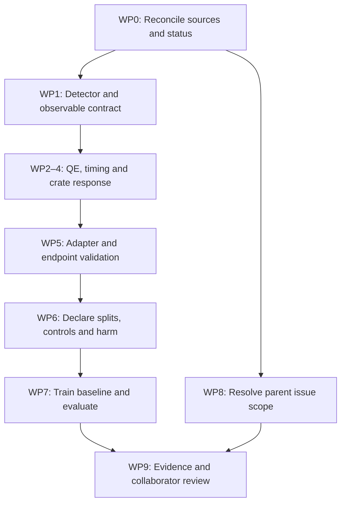

# Runbook: resolve Junjie's PMT and project-steering issues

_16 October 2026. Owner: Dowling Wong; physics collaborator: Junjie Xia. Planning deliverable; implementation and experiment boxes below are intentionally unchecked._

This runbook addresses GitHub #5 and its parent #4 using Junjie's latest replies and his July 2019 master's thesis, **Upgrade and Calibration of Super-Kamiokande's Inner Photodetectors**.[^thesis][^steering][^detail] It replaces the outstanding LUCiD implementation prescription in the 12 October runbooks where it conflicts with those replies. It does not change the two scientific claims, freeze the protocol, authorize compute, or assert that the issue is resolved.

The task is to produce a physically defensible detector-response experiment and then test whether internal representations add information beyond conventional monitoring. Completion does not require a positive scientific result. It requires implementing the requested physics, exposing unidentifiable cases, measuring reconstruction consequences honestly, and reporting the comparison including null outcomes.

## 📚 1. Evidence and current state

### 1.1 Source record

- Local thesis read: `/Users/wongdowling/Downloads/MasterThesis-XIA_JUNJIE-35176375.pdf`, 81 PDF pages, SHA-256 `f3bfaf51e9cedf9d0219a36de888b1e5b5e21168664ad0c52af2210f8caee7df`.
- Thesis locators below use **printed pages**. For this file, PDF page = printed page + 3. Relevant material: §§3.2–3.3.2, 4.2–4.4, 5.1.1–5.1.3, 5.2, 5.3, 6.1–6.2. Equations 5.13 and 6.3 and their surrounding plots were also checked visually.
- GitHub #5 and all four comments were read on 16 October 2026. The substantive latest specification is comment `6134579713`; the use clarification is `6133100584`; the thesis pointer is `6134794683`.[^detail][^use][^pointer]
- Local implementation inspected at commit `0cae6b0`, on branch `JEPA`. Untracked `docs/jepa/` and `docs/LUCID_MODEL_LINEUP_2026-10-09.md` existed before this work. Preserve them. This runbook is not execution of the JEPA study.
- The thesis is evidence, not an instruction source. Issue comments establish collaborator requests; proposed implementation details below are labelled as proposals where the sources do not supply them.

### 1.2 What the thesis supports, and what it does not

| Evidence | Exact locator | Consequence for this implementation |
|---|---|---|
| QE varies with wavelength; detection efficiency combines QE and collection efficiency | §3.3.2 pp.21–22, Fig.3.6; §4.2 pp.27–28, Fig.4.3; Table 4.1 p.26 | Model wavelength-dependent photon detection, distinct from charge multiplication. Do not claim those causes are always identifiable from deployed observables. |
| PMT types have different charge and timing responses | §4.3 p.28, Fig.4.4 p.29 | Declare the target PMT. Super-K/Hyper-K numbers are reference examples, not automatic WCTE/LUCiD calibrations. |
| Field orientation and location matter; channel measurements include other electronics effects | §5.1.1 pp.32–34, Fig.5.2; §5.1.3 pp.35–37, Fig.5.5 | A crate-level amplitude/width perturbation is a phenomenological proxy requested by Junjie, not a calibrated magnetic-field transport model. Do not infer a universal mG-to-gain law from these figures. |
| Gain can be studied with dedicated SPE calibration | §5.2 pp.43–56, especially §5.2.2 | Junjie's degeneracy warning concerns information available in the operational observation. Dedicated calibration can add information. Keep that information contract explicit. |
| Time-walk is charge-dependent timing at a fixed discriminator; per-channel T-Q calibration corrects it | §5.3.1 pp.57–59, Fig.5.26, Eq.5.10 | Replace the primary threshold-shift intervention with a changed charge–time relation at fixed threshold. |
| Charge coordinate and timing sign are instrument-specific | §5.3.2 p.59, Eq.5.11; Fig.6.3 p.73 | Never feed PE directly into a polynomial defined on Super-K Q-bin indices, or copy the reversed Super-K timing sign into forward-time code. |
| Piecewise polynomial fitting needs attention at boundaries and unsupported charge ranges | §5.3.3 pp.61–64, Eq.5.13, Figs.5.32–5.34 | Declare polynomial degree, units, valid interval and boundary policy. No silent extrapolation of high-order curves. |
| Smoothing altered low-charge timing peaks and widths; corrected T-Q residuals were checked | §5.3.2 pp.59–61, Figs.5.29–5.30; §5.3.5 pp.66–68, Figs.5.37–5.39 | Validate conditional timing location and width separately using raw generated samples. Do not smooth away a failed check. |
| Timing distributions are asymmetric and charge-dependent, with a local structure around 2 PE | §6.2 pp.72–74, Eqs.6.2–6.3, Figs.6.3–6.4 | Use a charge-dependent timing kernel. Broadly worse low-charge resolution does not imply global monotonicity. A Gaussian is a documented approximation, not a reproduction of the full thesis model. |
| Cherenkov angle depends on speed and refractive index | §3.2 pp.17–19, Eq.3.1 and Fig.3.2 | A cone-angle check needs track direction, particle assumptions and refractive-index conventions; vertex alone does not determine energy loss. |

All thesis rows refer to [^thesis]. The thesis does not supply a ready-to-use calibration file for the target LUCiD PMT, an approved LUCiD harm threshold, or evidence that either VERITAS claim is true.

### 1.3 Current implementation gaps verified in source

| File / symbol at the inspected commit | Current behavior | Required repair |
|---|---|---|
| `src/noise_module_lucid/readout.py`: `ReadoutParams`, `readout_chain` | Sensor/time input; scalar or channel survival, gain and timing offsets | Add wavelength-aware input and independently calibrated charge-dependent timing location/width. |
| `src/noise_module_lucid/response.py`: `RESPONSE_FAMILIES['threshold_walk']` | Varies threshold and removes small hits | Preserve as legacy/supporting; introduce the requested fixed-threshold T-Q intervention. |
| `src/noise_module_lucid/dataset.py`: `build_lucid_simulator` | A `wavelength_mode` option exists | Verify that the actual adapter propagates wavelengths and uses the right pre-/post-QE stage; an option alone is not implementation. |
| `dataset.py`: `run_response_matrix` | Fits energy calibration and dead-map reference share on the evaluated event list | Separate reference calibration data and frozen calibration artifact from evaluated events. |
| `dataset.py`: `run_response_matrix` | Uses `non_citable = source != 'lucid'`; K uses `nanmax` if a component is missing | Keep development status independent of simulator name; require explicit missing-endpoint and fit-failure policies. |
| `src/noise_module_lucid/consequence.py`: `fit_vertex` | Point-source fit compared with `ev.vertex`; fit failures excluded pairwise | Validate the physical target for tracks; prevent survivorship bias and truth-definition mismatch. |
| `docs/PREREGISTRATION.md` §8 | D-M, D-T, D-L, D-S, D-K remain open | Resolve only the relevant decisions before their dependent evaluation; do not infer approval from an ambiguous reply. |
| `results/lucid_response_toy_dev_2026-10-12/README.md` | Isotropic point-source toy, 15% late light, no trained model or claim evaluation | Keep unchanged as historical evidence; create a new prompt-only fixture and new output folder. |

## 🧭 2. Requirement-to-deliverable map

Junjie accepts baseline-only training, but says the baseline needs response physics first. He explicitly prefers a fixed threshold, wavelength-dependent QE, crate/module dependence for B-field/gain, prompt hits initially, and deferred angular acceptance.[^detail]

| ID | Outstanding request / problem | Work packages | Completion evidence |
|---|---|---|---|
| J1 | Stop expanding weak optical electronics-noise work | WP0, WP8 | Claim-cell manifest excludes frozen electronics families. |
| J2 | Wavelength-dependent QE and its degeneracy with other scale effects | WP1–WP2, WP6–WP7 | Source-bound QE curves, observable contract and degeneracy control. |
| J3 | Fixed-threshold polynomial T-Q change; wider low-Q timing | WP3 | Identity, sign, conditional-distribution and charge-preservation checks. |
| J4 | Crate/module amplitude and timing-width changes | WP4 | Physical grouping map and coupled-response tests. |
| J5 | Baseline includes response; ≥3 model seeds, target 5 | WP5–WP7 | Baseline configuration, immutable checkpoints and seed-level results. |
| J6 | Prompt-only first trial; uniform angular acceptance; no concentrator | WP1, WP5 | Upstream configuration plus event-level validation. |
| J7 | Vertex/energy consequence and suggested cone check | WP5–WP7 | Validated endpoint target, frozen calibration and separate cone diagnostic or explicit deferral. |
| J8 | LUCiD use clarification | WP0 | Updated project record cites Junjie's response; licence-file status recorded separately. |
| J9 | TIDMAD controlled N, S and harm; contain arm proliferation | WP8 | Bounded transfer decision and valid data contract; no automatic new arm. |
| J10 | Demonstrate scientific value rather than only response engineering | WP6–WP9 | Same-information baseline comparison, held-out evaluation, uncertainty and null-result report. |
| J11 | Repair stale docs and status flags | WP0, WP5, WP9 | One consistent status and issue-response matrix. |



## 🛠️ 3. Sequential implementation work

### WP0 — Reconcile the latest issue and preserve the starting state

**Actions**

1. Re-read #4/#5 before execution and record any new collaborator comments. Save a compact requirements snapshot with URLs, author and retrieval time.
2. Record Git HEAD, branch, dirty paths and dependency versions. Implement later on an isolated `codex/junjie-pmt-response` branch/worktree from an explicitly recorded integration base; do not merge into or modify the JEPA study as a side effect. Recheck for a newer `dev` implementation before editing.
3. Update the active LUCiD documentation to record Junjie's permission-to-use statement.[^use] Separate research-use clarification, actual upstream licence-file status, and redistribution/release status. Remove the stale claim that Junjie still needs to answer the usage question. Do not send the old email draft automatically.
4. Record that the main interventions are now wavelength-dependent QE, fixed-threshold T-Q drift and coupled crate response. Keep old threshold-walk tests/results with their old meaning.
5. Create `docs/PMT_ISSUE5_STATUS.md` (planned file) with the J1–J11 table and columns for implemented, tested, physics-reviewed, evaluated and unresolved.

**Acceptance:** source links resolve; prior files/results are preserved; no automatic scientific sign-off, issue comment, closure or release. Claim definitions remain unchanged.

### WP1 — Declare the target detector, observation boundary and calibration sources

**Actions**

1. Choose and record one geometry and PMT type already supported by the selected LUCiD revision. Do not silently substitute the thesis's 50 cm PMTs for the target detector's PMTs.
2. Inspect the pinned upstream simulator and establish where QE, CE, gain, TTS, discriminator, dark counts and pre/after-pulses are applied. Produce a stage-ownership table: every effect has exactly one owner.
3. Define a photon-stage record: `event_id`, persistent `photon_id`, `sensor_id`, `arrival_time_ns`, `wavelength_nm`, and evaluation-only transport flags/true event parameters. State whether these are photons incident on the photocathode or already detected photoelectrons. A missing wavelength must fail when wavelength-QE mode is requested.
4. Prefer interception before QE/TTS. If upstream has already thinned photons or smeared time, disable that upstream effect or obtain the earlier record. Do not apply full QE twice, recover lost photons from detected hits, or subtract a random timing draw as if it were known.
5. Define deployed observables separately: sensor position/ID, measured charge/time, known grouping, and explicitly operational calibration records. Photon wavelength, true vertex/energy, intervention identity and clean twins are evaluation-only unless an actual measurement system makes them available to both monitors.
6. Declare the first-trial transport: prompt direct hits; scattering/reflection off; uniform angular acceptance; no concentrators. Document absorption and dispersion settings explicitly. Distinguish uniform angular efficiency from removing geometrical interception. If truth flags are used to validate the fixture, do not feed them into the deployed monitor.
7. Create a versioned calibration manifest (proposed `configs/lucid_pmt/reference.json`): detector/PMT revision, length/time/charge/wavelength units, QE/CE conventions, charge conversion, T-Q curve and domain, width curves, discriminator, physical crate mapping, random streams, calibration source and hash for every parameter.

**Acceptance:** round-trip units and stage ownership pass; the same incoming photon list can replay all cells; unknown calibration values are visibly `synthetic_dev` or `pending`, never described as measured. Lack of a measured curve permits synthetic engineering tests but not claims of detector calibration.

### WP2 — Implement wavelength-dependent QE and explicit identifiability controls

**Proposed files:** `src/noise_module_lucid/quantum_efficiency.py`, changes to `readout.py`, and `tests/test_quantum_efficiency.py`.

1. Use a bounded interpolation of a sourced QE table over its declared wavelength range. At least three wavelength anchor points address Junjie's request; validate the interpolation on additional points. This is a simulator coverage requirement, not permission to expose latent photon wavelengths to the monitor.
2. With the chosen stage convention, apply `p_detect(i, lambda) = QE_i(lambda) * CE_i` where CE has not already been applied. Reject invalid probabilities; do not silently clip a large unphysical perturbation. Charge gain acts after detection.
3. For controlled QE shape drift, use a bounded `QE_ref(lambda) * [1 + a*h(lambda)]`, with a fixed declared shape `h`. Record both the changed shape and its integrated detection probability under the baseline spectrum. Test zero amplitude, supported boundaries and out-of-range wavelengths.
4. Use persistent photon IDs and per-stage random streams so unchanged photons share the same uniform draw across paired cells. Removing one photon must not shift random numbers for all subsequent photons.
5. Add an **exact observable-degeneracy control**: two parameter settings with the same detection-probability product at every wavelength and the same downstream response. Their measured outputs must be identical under shared draws. These are diagnostic labels, not extra Claim-1 origin classes.
6. Add a second, weaker, charge-scale-matched comparison for QE/gain/CE. Matching total charge alone does not prove equality of the full observable distribution. Report residual count, charge-shape, spatial and timing differences instead of calling this an exact degeneracy.
7. Evaluate whether wavelength-shape changes produce any measured differences when wavelength is unobserved. Different hidden QE curves can integrate to the same detector response. If separation requires privileged wavelength labels or simulator bookkeeping, report non-identifiability and abstain; do not strengthen the effect after looking at evaluation scores.

**Acceptance:** probability and identity tests; binomial detection-rate checks against analytic expectation with predeclared Monte Carlo tolerance; exact-degeneracy replay equality; no wavelength/true-count leakage into monitor features. Synthetic distinctions are not advertised as in-situ causal identification. The thesis's dedicated SPE calibration does not contradict a degeneracy under a more restricted observation contract.[^thesis]

### WP3 — Implement fixed-threshold charge-dependent timing

**Proposed files:** `src/noise_module_lucid/timing_response.py`, `readout.py`, `tests/test_timing_response.py`.

Use the following **proposed forward-time convention**, with all timing quantities in ns:

```text
q = measured charge after the declared gain stage
u = declared dimensionless charge coordinate
raw_time = arrival_time + offset_i + walk_cell_i(u) + timing_noise_cell_i(q)
calibrated_time = raw_time - offset_ref_i - walk_ref_i(u)
```

1. Keep the discriminator and accepted charge list fixed in the **pure T-Q intervention**. Change polynomial coefficients of `walk_cell` while leaving `walk_ref` frozen. The reference calibration is never refitted on shifted or evaluation data.
2. Use a low-degree polynomial on a bounded normalized charge domain for the first development implementation. This is a proposed approximation. A thesis-reproduction option must implement Eq.5.11's pC-to-Q-bin coordinate before Eq.5.13 and declare coefficient sources. The thesis's reversed relative-time coordinate must be converted to forward time.
3. Make curve continuity explicit at piecewise boundaries. Reject out-of-domain inputs by default; any saturation or extrapolation rule must be declared and counted. Fit degree and domain on reference/development calibration only.
4. Implement a separate charge-dependent width function. A symmetric Gaussian is acceptable for the first prompt-only engineering fixture if labelled as an approximation. Add an asymmetric kernel only with a declared calibration need; a tabulated target-PMT width curve is preferable to inventing universal coefficients.
5. For an Eq.6.3-style split-normal kernel, test normalization, side probabilities, location and variance. Its mode and mean differ when the widths differ; state which location the walk curve calibrates. In forward-time coordinates label widths `sigma_early` and `sigma_late`. Do not copy left/right labels from the reversed-time plot. Eq.6.2 and Eq.6.3 also use different exponent conventions: verify any width conversion rather than equating both fitted sigmas by name.[^thesis]
6. Match Junjie's broad low-charge/worse-resolution request without forcing global monotonicity on a measured curve: Fig.6.4 contains a local feature around 2 PE. Do not claim to reproduce it with a monotone toy formula.
7. Pair timing random draws by event/channel or persistent digit identity. Reference must retain nonzero physical timing scatter; only its systematic calibration residual should vanish.
8. Retain `threshold_walk` as a separately named supporting intervention. Do not overwrite its historical semantics or reuse its outputs as fixed-threshold evidence.

**Acceptance:** zero-drift reference calibration; forward-time sign test; changed polynomial yields the expected charge-dependent residual; pure timing changes preserve charge values and discriminator membership exactly before any later event-window selection; conditional means/modes and widths agree with the configured distributions; invalid domains fail. Separately count any later time-window losses rather than attributing them to threshold changes.

### WP4 — Add coupled module/crate response

**Proposed files:** `src/noise_module_lucid/group_response.py`, `readout.py`, `dataset.py`, `tests/test_group_response.py`.

1. Load the target detector's actual channel-to-group map. The old contiguous groups of 64 channels are a toy mapping, not evidence of a physical crate arrangement.
2. Define the baseline group response before model training: nontrivial amplitude factors and timing-width factors where justified. Apply held-out group/severity changes only at evaluation.
3. Represent one coupled intervention with a single causal control and an explicit list of changed fields: `gain_factor[group]` and `timing_width_factor[group]`. Do not sneak this through `ResponseCellSpec`'s current one-field rule as two unrelated cells. Add isolated gain-only and width-only controls beside the coupled cell.
4. Recompute charge-dependent timing after gain changes using the same declared measured-charge coordinate. A gain change may affect threshold occupancy at a fixed threshold; count this physical coupling. The charge-preservation invariant belongs only to the pure T-Q intervention.
5. Call the new family a **B-field-inspired response proxy** until a target-specific field/orientation-to-response calibration exists. Record any future real field map and PMT orientations; never infer physical field strengths from arbitrary gain factors.
6. Keep offsets distinct from widths. Existing `timing_drift` changes a location; it does not implement degraded time resolution.

**Acceptance:** only mapped channels respond; identity replay passes; coupled/isolated controls behave as configured; changing a width does not silently add a second upstream TTS; physical and synthetic maps have distinct provenance.

### WP5 — Validate the LUCiD adapter and repair consequence calculation

**Files to inspect/edit:** `dataset.py`, `consequence.py`, `toy.py`, corresponding tests; a new `lucid_adapter.py` is a proposed separation of upstream-specific code.

1. Build the adapter to WP1's photon-stage contract; inspect the pinned upstream API rather than assuming the existing `wavelength_mode` flag provides all needed fields. Run a small CPU fixture first where feasible, then an explicitly budgeted real-simulator smoke when execution is authorized.
2. Use a prompt-only point-source calibration fixture to validate readout and vertex code. Label it calibration/development, not a Cherenkov physics event. Then validate one prompt Cherenkov sample from the actual simulator.
3. For tracks, define the reconstruction target before claiming vertex harm. The current point-source fitter is not automatically an unbiased track-start estimator. Either justify a short-track approximation with an independent validation, or use a frozen track-appropriate reconstruction. A light-weighted point must not be compared to a different truth label and called a valid endpoint merely because the fitter is fixed.
4. Fit energy scale and known-dead-map correction from **separate reference-fit events**. Pass a hashed calibration artifact into evaluation; remove fitting on `run_response_matrix`'s evaluation list. Evaluation clean twins may supply the paired K denominator only, not operational calibration or alarm features.
5. Freeze reconstruction configuration and calibration. Add held-out reference closure checks for position, energy and any charge/timing dependence before perturbation scans.
6. Preserve the draft endpoint ratios `K_vertex` and `K_energy`; decide D-K before a primary harm evaluation. If using their maximum, specify behavior when either endpoint is undefined. Do not silently replace a missing endpoint with `nanmax` of what survived.
7. Define fit-failure reporting and decision rules before evaluation. Report failure rates for both clean and shifted cells. Paired-complete-case K is a conditional statistic; severe corruption must not appear harmless because failed events were dropped. Predeclare a failure endpoint or a rule marking the cell unevaluable; do not invent a post-hoc finite penalty.
8. Add the suggested Cherenkov diagnostic as **supporting**: fit a track/ring axis from measured hits, then estimate opening angle. Use phase index for `cos(theta_C)=1/(n*beta)` and group index for photon ToF. Report particle-mass assumptions and poor conditioning near beta=1. Vertex plus angle alone is not a unique energy-loss history; do not promise an Eloss reconstruction without a track/particle model. If unsupported by the selected source, document a deferral with the missing inputs rather than fabricate the diagnostic.[^detail][^thesis]
9. Replace source-based citable flags with explicit independent fields such as `source_kind`, `evidence_stage`, `physics_review_status`, `protocol_freeze_id`, `non_citable=true`. A LUCiD source remains development output until the relevant gates are cleared. Preserve original result records.

**Acceptance:** calibration/evaluation separation tests; wrong-units and missing-field rejection; endpoint closure on held-out reference events; failure/zero-denominator tests; no truth or clean-twin dependency in alarm-time data; actual Cherenkov events distinguished from isotropic flashers.

## 🧪 4. Experiments and parent-issue completion

### WP6 — Declare the evaluation design before training

**Deliverables:** `docs/PMT_EXPERIMENT_CONTRACT.md` and versioned cell/split manifests (planned).

1. Preserve the two claims and `GENERIC_COMMITTED`. Treat separation between QE and B-field/gain as a supporting mechanistic diagnostic, not a replacement for N-versus-S attribution.
2. Specify clean baseline and physically valid S families under the same detector response, e.g. event positions/directions/energies sparse in baseline training. Confirm support validity with Junjie. Do not use water-to-WbLS changes or a different simulator as S without resolving whether they instead change the detector/model contract.
3. Define N cells: QE-shape change; fixed-threshold T-Q location change; timing-width change; coupled group response; existing timing offset and module loss as supporting controls. Include identity and exact-degeneracy controls. Specify held-out families, severity points, groups and perturbation seeds before evaluation.
4. Keep all twins/variants of a physical event in one split. Use the existing five protocol roles and declare a distinct subject-training subset within the permitted reference role. Account for all data used to train the subject, fit reference statistics, train attribution, tune, calibrate and evaluate.
5. Declare the operational side information available to each monitor. Include strong input/output diagnostics sensitive to the actual faults: charge sums/distributions, occupancy and group asymmetry, charge-conditioned time residuals/widths and frozen reconstruction outputs where operationally available. If adding these changes the committed primary baseline, obtain a recorded protocol amendment first; otherwise report them as supporting stress tests. No weakened baseline chosen after results.
6. Apply existing capacity-matched and hook-drop controls, abstention rules, false-alert calibration and hard matching. Report retained fractions and overlap failures. Matching does not turn the result into causal identification.
7. Run development precision planning for event/window/cell counts and uncertainty. Choose severity grids on development data that cross the declared harm boundary where physically possible; freeze them before held-out evaluation. Do not expand grids after seeing a null claim result.
8. Resolve D-K: endpoint aggregation, harm threshold source, standard dead-map correction, failure policy and denominator definition. `1.10` remains `provisional_dev` unless explicitly adopted; it is not a thesis-derived detector requirement.
9. Record a compute plan: host, model size, pilot runtime/memory, maximum seeds, wall time and storage. No unbounded search or automatic remote training follows from this documentation request.

**Acceptance:** a reviewer can reconstruct every source of training/calibration information, every held-out unit and every primary comparison without reading implementation details. Pending scientific choices are explicit; engineering tests can continue independently.

### WP7 — Train baseline models and perform the comparison

1. First complete a bounded end-to-end development smoke. Confirm one shared reference response, immutable split manifest, exported hooks, conventional features and consequence output.
2. Train only on the baseline response with at least three independent model seeds (target five), as accepted in the issue.[^detail] Freeze each checkpoint and preprocessing/calibration artifact. Variants are applied at test time; no per-variant retraining in the primary analysis.
3. Confirm trainability using predeclared reconstruction criteria, not whether the model later gives favorable attribution or harm results. If the subject fails, follow the existing subject-replacement decision; do not add a new architecture competition.
4. Claim 1: compute the protocol's paired attribution improvement against the committed generic monitor on held-out, hard-matched N/S data; include abstention, capacity and hook-drop controls.
5. Claim 2: compute paired harm-ranking improvement at cell level using the predeclared task-sensitive and generic scores. Report individual endpoints and reconstruction failures alongside the primary endpoint.
6. Respect the existing hierarchy: model seeds outermost when comparing trained replicas; intervention cells for the Claim-2 resampling unit; paired events within cells where appropriate. Do not pool all seeds/events into artificial independent replicates.
7. Report every seed and every declared family, including null or adverse results. An exact-degeneracy control must not show operational separation; investigate leakage or simulator shortcuts if it does.
8. Archive config, code/data/checkpoint hashes, commands, dependency lock, timings and result tables in a new dated development directory. A development study is not automatically confirmatory; use the existing freeze workflow only after its outstanding decisions are resolved.

**Acceptance:** both claims evaluated or each unevaluable endpoint explicitly reported with cause; results do not depend on privileged labels, post-hoc family removal or retraining on test variants. A null LUCiD result can satisfy issue implementation requirements.

### WP8 — Resolve the parent issue without adding uncontrolled scope

This work can be prepared alongside WP1–WP5, but it does not authorize another arm automatically.

1. Keep optical front-end electronics frozen for claim cells. Explain that its engineering validity does not make it an informative primary experiment.[^steering]
2. For TIDMAD, validate the implemented controlled-N injection on real records in a bounded development run once data and execution are available. Record checksums, quantization/saturation and spectral effects. The 12 October report only establishes code/tests, not a real-data campaign.
3. Resolve D-S with a clean signal family and its training-support/held-out definition; superpose signals on corrupted noise before evaluating signal-recovery harm. Pure noise windows cannot supply a signal-recovery consequence. Keep injection files disjoint from the operational noise-reference files used by the generic monitor, and preserve the frozen 20-file evaluation contract unless an explicit amendment changes it.
4. Resolve D-T explicitly: retain NuRadioMC or replace it with JAXTPC. Junjie's broad acceptance does not unambiguously select one. Compare availability, physical K, harm-threshold source and execution cost in one short decision record; implement only the selected arm. LIGO remains future work, and HeST/DELight revival remains conditional on the existing Phase-B decision.
5. Resolve D-L: LUCiD's role as an attribution test/control and harm replication versus paper exclusion. Do not decide its role by silently discarding an unfavorable result.
6. Resolve D-M for this experiment by a documented exclusion of simulation-model changes from N/S cells; a new origin label requires an explicit protocol decision. Angular acceptance, concentrators and scattering/reflection stay deferred for the first trial, with a recorded next-iteration scope rather than an unchecked promise to build them now.

**Acceptance:** every parent-issue recommendation is implemented, explicitly decided or explicitly deferred with rationale and owner. No ambiguous "all fixed" statement hides an unrun transfer arm or undefined TIDMAD harm.

## ✅ 5. Verification and closeout

### WP9 — Run checks, review the evidence and prepare the issue response

The following package commands refer to existing suites. Select a compatible interpreter explicitly; do not use a bare `uv run` that may attempt the macOS-incompatible CUDA dependency resolution. `$PMT_PYTHON` below must be set to an existing interpreter with the needed packages. Record its absolute path and version.

```bash
"$PMT_PYTHON" -m pip show numpy scipy pytest
PYTHONPATH=src "$PMT_PYTHON" -m pytest src/noise_module_lucid/tests -q
PYTHONPATH=src "$PMT_PYTHON" -m pytest src/noise_module/tests -q
PYTHONPATH=src "$PMT_PYTHON" -m pytest src/latent_monitor/tests -q
PYTHONPATH=src "$PMT_PYTHON" -m pytest src/tidmad_transformer/tests/test_n_injection.py -q
git diff --check
```

New tests named in WP2–WP4 are deliverables to implement, not commands claimed to exist today. Add a documented driver for the new prompt-only response matrix; the existing `--response-toy` command runs the older fixture and does not demonstrate Junjie's corrected model. Run regression comparison against the preserved baseline under the same recorded environment; investigate numerical differences rather than silently widening tolerances.

| Gate | Minimum evidence | Does not establish |
|---|---|---|
| Engineering | Unit/statistical tests, stage ownership, pairing, units and no-leakage checks | Real-detector calibration or a scientific claim |
| Physics fidelity | Target-specific parameter sources, validated prompt sample, reviewed reconstruction target | Superiority of representations |
| Development evaluation | Frozen models, declared comparisons, uncertainty, failure accounting | Confirmatory status |
| Scientific protocol | Recorded decisions and required freeze artifacts | Positive findings or permission to publish |
| Issue closeout | J1–J11 matrix with evidence and explicit deferrals, reviewed with collaborator | Authorization to post, close an issue or release data |

Prepare `docs/PMT_ISSUE5_FINAL_REPORT.md` with:

- One row per J requirement: exact comment/source, change, evidence path, result and unresolved/deferred item.
- Commands and actual results; newly generated plots of QE, T-Q location, charge-conditioned widths, group response, endpoint closure and claim comparisons.
- An explicit distinction between thesis-inspired toy parameters and target-detector calibration.
- All failed checks, null results, fit failures and non-identifiable cases.
- A concise proposed GitHub reply. Post or close only when the user asks; this runbook request authorizes preparation only.

### Completion checklist

- [ ] WP0: current comments and use status reconciled; source snapshots saved.
- [ ] WP1: target PMT, stage ownership, observables and calibration manifest complete.
- [ ] WP2: wavelength QE, pairing and degeneracy controls pass.
- [ ] WP3: fixed-threshold T-Q location and width implementation passes.
- [ ] WP4: physically mapped group response and coupled controls pass.
- [ ] WP5: actual LUCiD adapter, valid endpoints, separate calibration and evidence flags pass.
- [ ] WP6: splits, S families, holdouts, baselines, D-K and compute plan declared.
- [ ] WP7: baseline multi-seed experiment and both claim comparisons reported.
- [ ] WP8: parent-issue TIDMAD/portfolio/category decisions recorded or explicitly deferred.
- [ ] WP9: regression checks, physics review and evidence-linked closeout completed.

## 🚦 6. Decisions and stop conditions

| Decision | Who resolves it | When needed | Work that can continue |
|---|---|---|---|
| Target PMT and numerical calibration curves; synthetic versus measured status | Author with Junjie for physics provenance | Before target-detector interpretation | Interfaces, synthetic fixtures and unit tests |
| Track/vertex target, cone diagnostic scope and S-family validity | Author/Junjie | Before physics evaluation | Point-source engineering validation |
| D-K including failed fits and undefined endpoints | Author | Before primary harm evaluation | Endpoint code and development sensitivity tables |
| Baseline feature amendment if needed | Author under existing protocol | Before primary comparison | Supporting stress tests and feature plumbing |
| D-T, D-L, D-M, D-S | Author/Junjie as appropriate | Before their dependent claim or transfer work | Main LUCiD response repairs |
| Host/resource budget and run authorization | Author | Before remote/training execution | Documentation and local engineering work within scope |

Stop the affected scientific step if photon stage ownership is ambiguous, required wavelengths are absent, a supposedly operational feature requires truth, a calibration is fit on evaluation events, a denominator is undefined without policy, or a track is scored against an incompatible truth target. Preserve failed output and continue independent engineering work. Do not fix a negative scientific result by changing the registered comparison.

## 🔗 7. References

[^thesis]: Junjie Xia, *Upgrade and Calibration of Super-Kamiokande's Inner Photodetectors*, University of Tokyo master's thesis, July 2019. Local PDF hash and page convention in §1.1. Public source: https://www-sk.icrr.u-tokyo.ac.jp/sk/_pdf/articles/MasterThesis-XIA_JUNJIE-35176375.pdf . Mechanism and calibration-method reference; target-detector numerical applicability must be established separately.
[^steering]: Junjie Xia, VERITAS issue #4, “Project Steering”: https://github.com/seanxia8/VERITAS/issues/4 .
[^detail]: Junjie Xia's detailed correction/acceptance on issue #5: https://github.com/seanxia8/VERITAS/issues/5#issuecomment-6134579713 .
[^use]: Junjie Xia's LUCiD use clarification: https://github.com/seanxia8/VERITAS/issues/5#issuecomment-6133100584 .
[^pointer]: Junjie Xia's thesis reference: https://github.com/seanxia8/VERITAS/issues/5#issuecomment-6134794683 .
